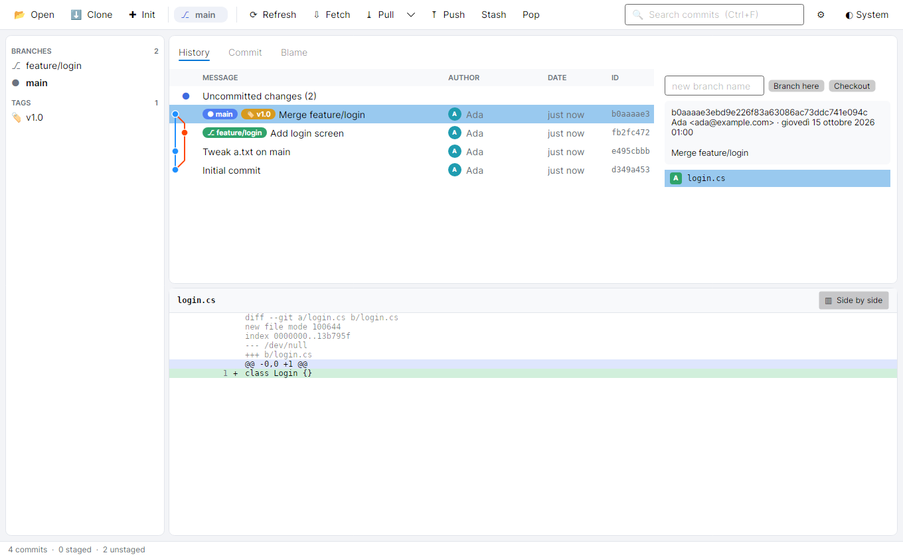
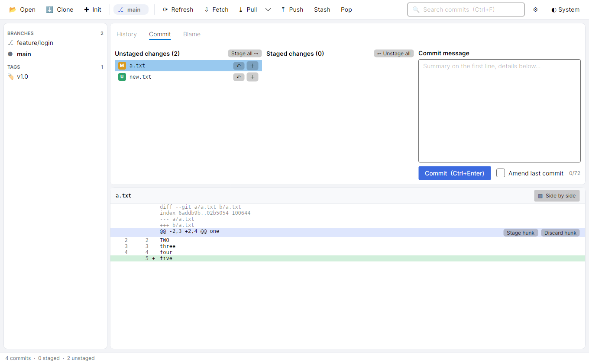
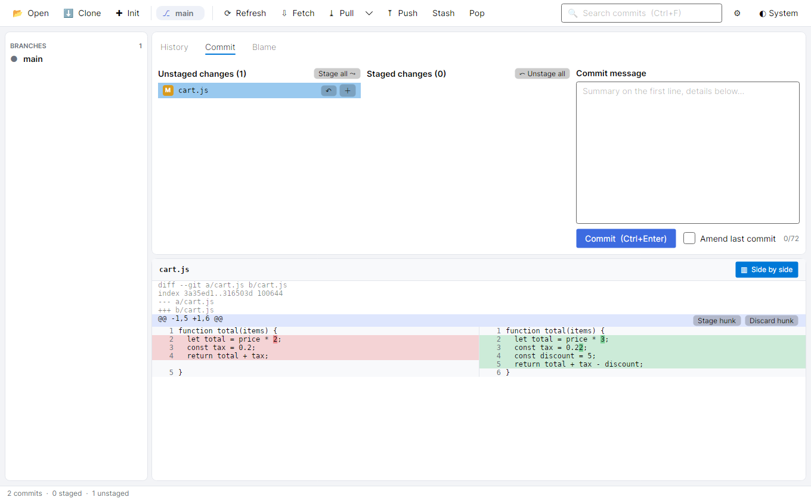
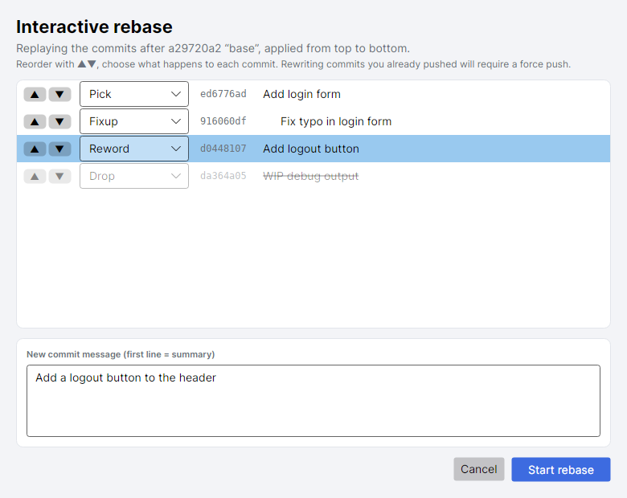
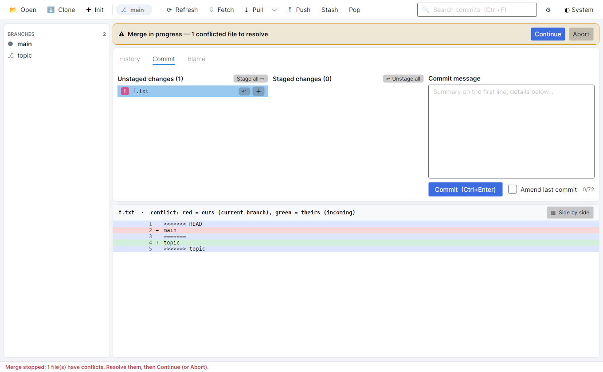
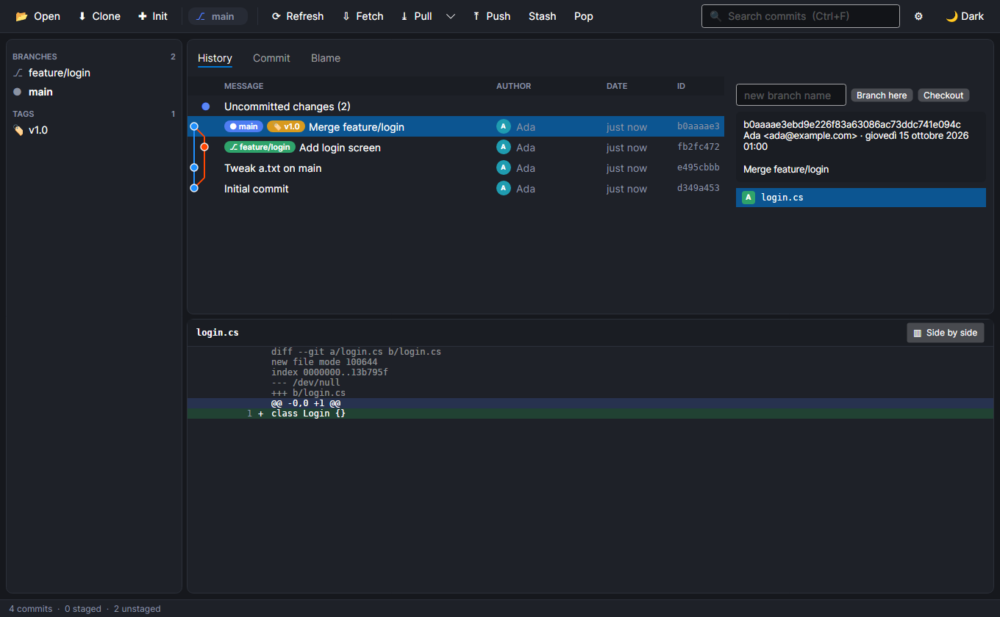
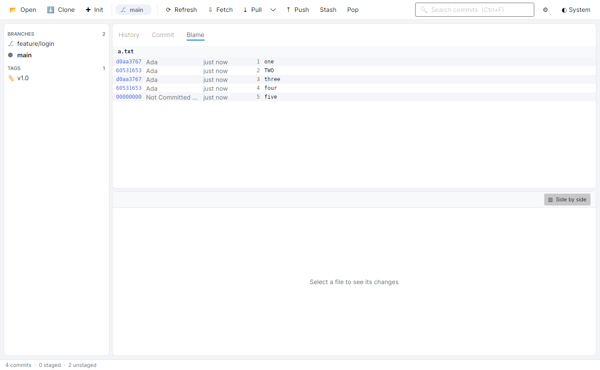

<div align="center">


# git-cross

**A fast, native Git client for Linux, macOS and Windows.**
History graph, staging by file / hunk / line, interactive rebase, blame, stashes, submodules and conflict resolution — in one clean window.

[](https://github.com/giamplai/git-cross/actions/workflows/ci.yml)
[](LICENSE.md)


[User guide](docs/HOWTO.md) · [Install](#install) · [Build from source](#build-from-source) · [Contributing](CONTRIBUTING.md) · [Changelog](CHANGELOG.md)

</div>

<p align="center">
  
</p>

---

## Why

Good graphical Git clients are plentiful on one platform or another; a complete, fast one that looks and behaves the same
everywhere is rare. git-cross is built on [.NET](https://dotnet.microsoft.com) and
[Avalonia](https://avaloniaui.net) (GPU-accelerated through Skia) and drives your real `git` executable, so your hooks,
credential helpers, SSH configuration and `.gitconfig` behave exactly as they do in a terminal.

It is **inspired by [Git Extensions](https://github.com/gitextensions/gitextensions)**, the Windows Git client — see
[Credits](#credits).

## Features

| | |
|---|---|
| **History** | Lane-based commit graph, branch / tag / remote chips, author avatars, relative dates, instant search (message, author, hash, ref), per-file history that follows renames. A 10 000-commit history opens in roughly 0.2 s on a development machine. |
| **Staging** | Stage, unstage and discard by **file**, by **hunk** or by **individual selected lines**. Amend. Commit-message length guide. |
| **Diffs** | Unified and **side-by-side** views with **character-level highlighting** of what changed inside a line, and line numbers. |
| **Branches & tags** | Create, checkout, delete, tag from any commit. Merge (default / no-fast-forward / squash). Rebase and pull with rebase. |
| **Rewriting history** | **Interactive rebase** with reorder, reword, squash, fixup and drop, with live validation. Cherry-pick, revert, reset (soft / mixed / hard, with confirmation). |
| **Conflicts** | A banner shows the paused operation; per-file *ours / theirs*, continue or abort for merge, rebase, cherry-pick and revert. Hand files to an **external three-way merge tool** (Collaterale, Meld, KDiff3, VS Code or your own command). |
| **Blame** | Per-line authorship at any commit or in the working tree; double-click jumps to the commit. |
| **Stashes** | Create, list, inspect, apply, pop, drop. |
| **Submodules** | Status icons, initialize / update, open as a repository and come back, recursive clone. |
| **Everyday** | Clone / init dialogs, recent repositories, fetch / pull / push with ahead-behind counters, light / dark / system themes, Settings (git path, identity, pull mode, history size). |
| **Safe by default** | Destructive actions ask first; untracked files are never deleted by a single click; external tools write to a temporary file and only replace your file when they report success. |

<table>
  <tr>
    <td></td>
    <td></td>
  </tr>
  <tr>
    <td></td>
    <td></td>
  </tr>
  <tr>
    <td></td>
    <td></td>
  </tr>
</table>

More screenshots and every feature explained step by step: **[docs/HOWTO.md](docs/HOWTO.md)**.

## Install

> Requires **git** to be installed ([git-scm.com](https://git-scm.com)). The packages are self-contained and do **not** need .NET.

Download the package for your system from the **[Releases](https://github.com/giamplai/git-cross/releases)** page:

| System | Package | How |
|---|---|---|
| Debian, Ubuntu, Mint… | `git-cross_<version>_amd64.deb` (or `arm64`) | `sudo apt install ./git-cross_*.deb` — adds a menu entry and the `git-cross` command |
| Any Linux | `git-cross-<version>-linux-x64.tar.gz` (or `linux-arm64`) | extract, then `./install.sh` for a per-user install, or just run `./git-cross` |
| Windows (x64) | `git-cross-<version>-win-x64.zip` | extract and run `git-cross.exe` |
| macOS 11+ | `git-cross-<version>-osx-arm64.zip` (Apple silicon) or `osx-x64` (Intel) | unzip and move *git-cross.app* to Applications |

Verify downloads against `SHA256SUMS`.

> **Unsigned builds.** The Windows and macOS packages are not code-signed yet, so SmartScreen / Gatekeeper will warn the first
> time (Windows: *More info → Run anyway*; macOS: right-click the app → *Open*). Details in the
> [user guide](docs/HOWTO.md#1-installing-and-starting-the-app).

## Quick start

```bash
git-cross                 # reopens the last repository, or shows the welcome screen
git-cross /path/to/repo   # open a repository directly
```

| Shortcut | Action |
|---|---|
| `Ctrl+O` | Open a repository |
| `F5` | Refresh |
| `Ctrl+F` | Search commits |
| `Ctrl+Enter` | Commit (in the message box) |

## Build from source

You need the [.NET 10 SDK](https://dotnet.microsoft.com/download) and `git`.

```bash
git clone https://github.com/giamplai/git-cross.git
cd git-cross
git config core.hooksPath scripts/hooks   # optional: the project's pre-commit checks

dotnet run --project src/GitCross.App -- /path/to/a/repo
scripts/check.sh                          # build (warnings are errors) + all tests
scripts/package.sh linux-x64              # release packages into artifacts/packages
```

Every package can be cross-built from any OS (`scripts/package.sh` with no argument builds Linux, Windows and macOS).
See [docs/RELEASING.md](docs/RELEASING.md) and [docs/DEVELOPMENT.md](docs/DEVELOPMENT.md).

## How it works

```
GitCross.App  (Avalonia · MVVM · compiled bindings)
    │  view-models call
GitCross.Core (no UI code)  ──►  runs the `git` executable (no shell, machine-readable output)
    ├─ GitRepository   one method per operation (log, status, stage, rebase, …)
    ├─ Parsers         pure functions for git's porcelain / -z / custom formats
    ├─ Diff / Graph    unified-diff model, intra-line changes, side-by-side rows, lane layout
    └─ Tools           command templates for external merge / diff programs
```

* **Tested against real repositories.** Core tests create temporary repositories (conflicts, submodules, large histories);
  UI tests render the real window headlessly and also generate the screenshots used in the guide.
* **No shell, ever.** Arguments are passed as argument lists, so unusual file or branch names cannot be re-interpreted.
* More: [docs/ARCHITECTURE.md](docs/ARCHITECTURE.md) · feature map [docs/PORTING.md](docs/PORTING.md) · plans [ROADMAP.md](ROADMAP.md).

## Status

Version **0.1** — usable for daily work, but young. Known gaps (see *Known limitations* in the guide): no built-in three-way
merge editor (use an external tool), no syntax highlighting in diffs, no folder compare of two commits, no plugin system, no
localization, unsigned Windows / macOS packages. Windows and macOS builds are produced by CI but have had far less hands-on
testing than Linux. Bug reports and ideas are very welcome.

## Contributing

Contributions are welcome — bug reports, ideas, documentation, code. Please read **[CONTRIBUTING.md](CONTRIBUTING.md)** and the
**[Code of Conduct](CODE_OF_CONDUCT.md)** first. Security issues: see **[SECURITY.md](SECURITY.md)**.

## Credits

* **Author and maintainer:** [Giampiero Lai](https://github.com/giamplai).
* **Inspiration:** [Git Extensions](https://github.com/gitextensions/gitextensions) — thank you to its authors and contributors for
  showing what a practical, complete Git GUI looks like. This is an independent implementation that contains none of its code,
  translations or artwork, and is **not affiliated with or endorsed by** that project
  ([how this is verified](docs/PROVENANCE.md)).
* **Built with** [Avalonia](https://avaloniaui.net), [SkiaSharp](https://github.com/mono/SkiaSharp),
  HarfBuzzSharp, the [Inter](https://rsms.me/inter/) typeface and the [.NET](https://dotnet.microsoft.com) runtime —
  full notices in [THIRD-PARTY-NOTICES.md](THIRD-PARTY-NOTICES.md).
* **Companion:** [Collaterale](https://github.com/giamplai/Collaterale), a compare-and-merge tool by the same author, is
  supported as the preferred external merge/diff tool.

## License

[MIT](LICENSE.md) © 2026 Giampiero Lai. You are free to use, copy, modify, merge, publish, distribute and sell this software,
provided the copyright notice and license text are kept — that is the credit to the author. Other components keep their own
licenses ([THIRD-PARTY-NOTICES.md](THIRD-PARTY-NOTICES.md), [NOTICE.md](NOTICE.md)).
