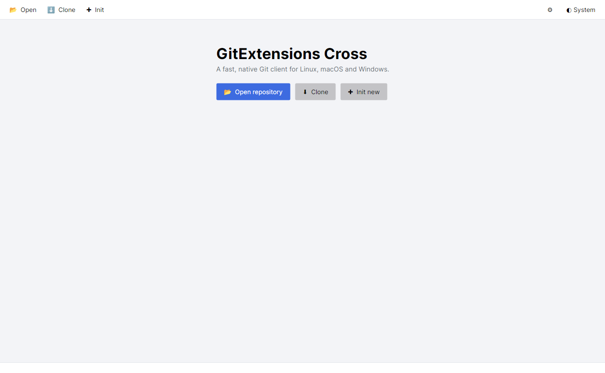
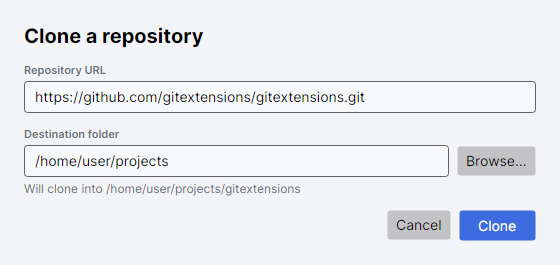
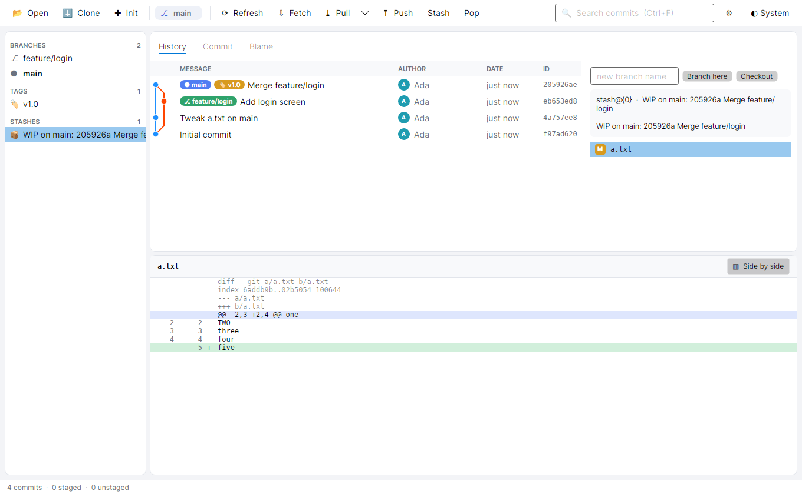
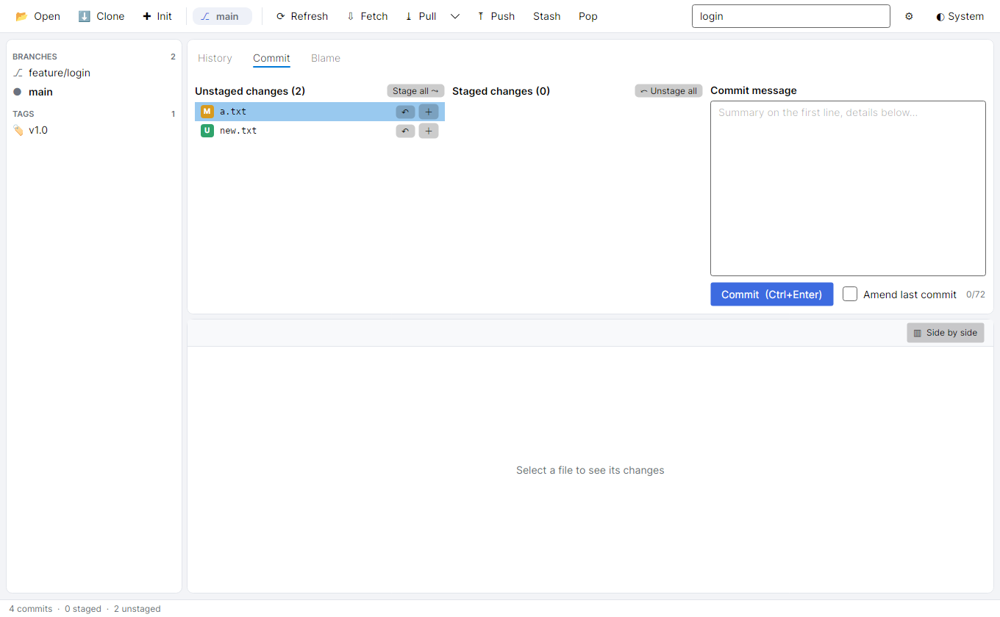
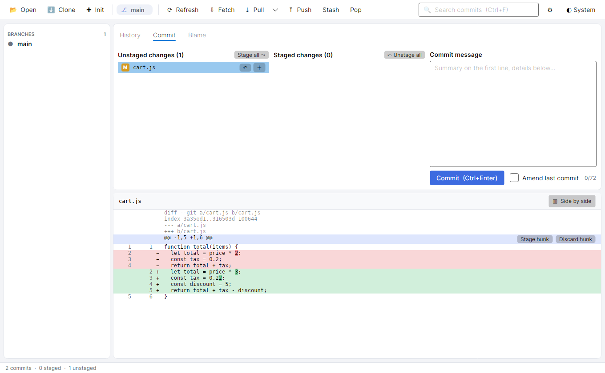
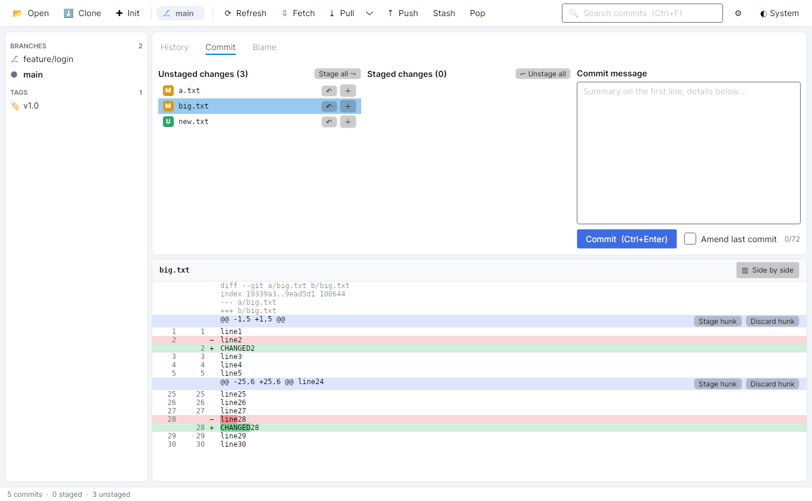
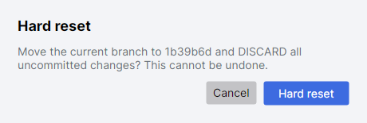
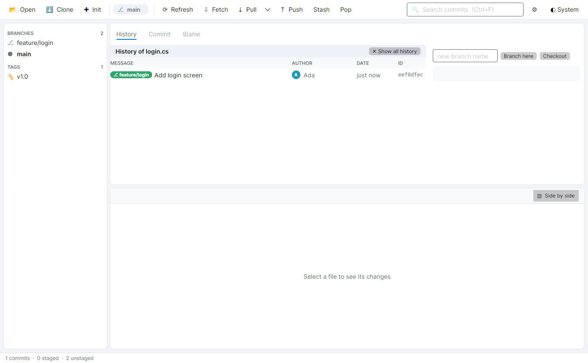
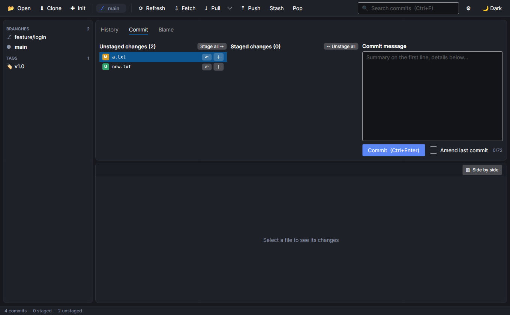
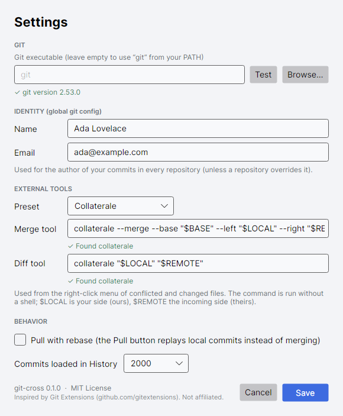

# git-cross — How to use

A fast, native Git client for **Linux, macOS and Windows**. This guide covers every feature, step by step.
All screenshots are generated from the real application by `scripts/update-docs.sh`, so they match the current version.

> **Keeping this guide current:** every commit that changes visible behavior must update this file (enforced by the pre-commit hook).

## Contents

1. [Requirements and starting the app](#1-requirements-and-starting-the-app)
2. [The welcome screen: open, clone, init](#2-the-welcome-screen-open-clone-init)
3. [Window overview](#3-window-overview)
4. [Toolbar](#4-toolbar)
5. [Sidebar: branches, remotes, tags, stashes](#5-sidebar-branches-remotes-tags-stashes)
6. [History and the commit graph](#6-history-and-the-commit-graph)
7. [Searching commits](#7-searching-commits)
8. [Commit details and the diff viewer](#8-commit-details-and-the-diff-viewer)
9. [Making a commit (stage, unstage, discard, hunks, amend)](#9-making-a-commit)
10. [Branches and tags](#10-branches-and-tags)
11. [Fetch, pull and push](#11-fetch-pull-and-push)
12. [Stashes](#12-stashes)
13. [Rewriting and moving: cherry-pick, revert, reset](#13-cherry-pick-revert-reset)
14. [Blame and file history](#14-blame-and-file-history)
15. [Resolving conflicts](#15-resolving-conflicts)
16. [Themes](#16-themes)
17. [Settings dialog and stored data](#17-settings-dialog-and-stored-data)
18. [Keyboard shortcuts](#18-keyboard-shortcuts)
19. [Safety: what asks for confirmation](#19-safety-what-asks-for-confirmation)
20. [Troubleshooting](#20-troubleshooting)
21. [Known limitations](#21-known-limitations)

---

## 1. Requirements and starting the app

* **git** must be installed and on your `PATH` (the app runs the real `git` command, so your hooks, credential helpers and SSH config all work exactly as in a terminal).
* To run from source you need the **.NET 10 SDK**.

```bash
dotnet run --project src/GitCross.App                 # reopens your last repository
dotnet run --project src/GitCross.App -- /path/to/repo   # opens a specific repository
```

Release builds (`scripts/publish.sh`) are self-contained single files for `linux-x64`, `osx-arm64` and `win-x64`.

When the app starts it opens the repository given on the command line; otherwise it reopens the **last repository you used**; if there is none, it shows the welcome screen.

## 2. The welcome screen: open, clone, init



Three ways to get a repository:

| Button | What it does |
|---|---|
| **Open repository** (also **Ctrl+O**) | Pick any folder that is, or is inside, a git working tree. The app finds the repository root automatically. |
| **Clone** | Opens the clone dialog (below). |
| **Init new** | Pick a folder; the app runs `git init` there and opens it. |

The same three actions are always available at the left of the toolbar.
Below the buttons, **Recent** lists the last 15 repositories; click one to open it.

### Cloning a repository



1. Paste the **Repository URL** (HTTPS, SSH or a local path).
2. Choose the **Destination folder** (the parent folder; use **Browse…**). The dialog shows the exact folder that will be created, taken from the URL (`…/gitextensions.git` → `gitextensions`). The last folder you used is remembered.
3. Click **Clone**. A progress bar is shown. On success the new repository opens automatically.

Errors (empty URL, destination already exists and is not empty, network or authentication failures) appear in red inside the dialog and nothing is created. Clone never prompts interactively; use an SSH key or a configured credential helper for private repositories.

## 3. Window overview


| Area | Purpose |
|---|---|
| **Toolbar** (top) | Open/Clone/Init, current branch, sync actions, search, theme. |
| **Sidebar** (left) | Branches, remotes, tags and stashes. |
| **Tabs** (upper right) | **History**, **Commit** and **Blame**. |
| **Diff panel** (lower right) | The changes of the selected file. |
| **Status bar** (bottom) | Commit count, staged/unstaged counts, progress and error messages (errors are red). |

Drag the thin separators between areas to resize them. The window refreshes itself when you switch back to it, so changes made in a terminal or editor show up automatically (this background refresh never hides an error message you have not read).

## 4. Toolbar

| Control | Action |
|---|---|
| **Open / Clone / Init** | See [section 2](#2-the-welcome-screen-open-clone-init). |
| **Branch pill** | Shows the current branch (or "detached HEAD") and, when the branch tracks a remote, `↑ahead ↓behind` commit counts. |
| **Refresh** (**F5**) | Reload history, refs and working tree. |
| **Fetch** | `git fetch --all --prune`. |
| **Pull** | `git pull` using your default mode (merge, or rebase if you enabled it in Settings). Click the **▾** arrow next to it for **Pull (merge)** or **Pull (rebase)** to choose explicitly; rebase replays your local commits on top of the fetched ones instead of creating a merge commit. |
| **Push** | `git push`. |
| **Stash** | Stash all changes including untracked files. Does nothing when the working tree is clean. |
| **Pop** | Apply and remove the newest stash. |
| **Search box** (**Ctrl+F**) | Filter the history, see [section 7](#7-searching-commits). |
| **⚙ Settings** | Opens the settings dialog ([section 17](#17-settings-dialog-and-stored-data)). |
| **Theme button** | Cycles System → Light → Dark. |

While a git command runs, a progress bar appears at the right of the status bar.

## 5. Sidebar: branches, remotes, tags, stashes



The sidebar lists, with counts:

* **BRANCHES** – local branches; the current one is bold with a ● marker.
* **REMOTES** – remote-tracking branches such as `origin/main`.
* **TAGS** – all tags.
* **STASHES** – saved stashes (only shown when you have some).

Interactions:

* **Single click** – selects the ref and scrolls/selects the matching commit in History. Nothing is changed in your repository by a single click.
* **Double-click** a branch or tag – checks it out. Double-clicking a remote branch such as `origin/feature` creates a local tracking branch `feature` (git's standard behavior).
* **Right-click** – context menu:
  * Branches/remotes/tags: **Checkout**, the merge and rebase entries described in [section 10](#10-branches-and-tags), and **Delete branch** (uses the safe `git branch -d`; unmerged or current branches are refused with a message).
  * Stashes: **Apply stash (keep)**, **Pop stash (apply and drop)**, **Drop stash** (asks for confirmation).

## 6. History and the commit graph


Each row of the **History** tab is one commit:

* **Graph** – coloured lanes show branching and merging. The dot is the commit; lines connect it to parents.
* **Chips** – labels on the row: ● blue = current branch, ⎇ green = branch, ☁ grey = remote branch, 🏷 amber = tag.
* **Message**, **Author** (with a coloured initials avatar), **Date** (relative: "5 min ago", "3 days ago"; hover for the exact time) and the short **ID**.
* The first row **Uncommitted changes (N)** appears when your working tree has changes. Selecting it switches to the **Commit** tab.

The list shows the most recent commits across all branches (2000 by default; adjustable in [Settings](#17-settings-dialog-and-stored-data)). Stash internals are deliberately hidden from the graph.

Click a commit to see its details on the right (section 8).

### Commit context menu

Right-click any commit:

| Item | Effect |
|---|---|
| **Checkout this commit** | Detached-HEAD checkout of that commit. |
| **Create tag here…** | Asks for a tag name, then creates a lightweight tag on that commit. |
| **Cherry-pick onto current branch** | Applies that commit on top of the current branch (see [section 13](#13-cherry-pick-revert-reset)). |
| **Revert this commit** | Creates a new commit that undoes it (merge commits are reverted against their first parent). |
| **Reset current branch to here → Soft / Mixed / Hard** | Moves the branch pointer. Hard asks for confirmation. |
| **Copy commit hash** | Copies the full 40-character hash to the clipboard. |

## 7. Searching commits



Type in the search box (or press **Ctrl+F** to focus it). The history is filtered live to commits whose **message**, **author**, **hash prefix** or **branch/tag name** contain the text (case-insensitive). While a filter is active the graph is hidden, because a filtered list is no longer a connected history. Clear the box to return to the full graph.

## 8. Commit details and the diff viewer

When a commit is selected, the right-hand pane of the History tab shows:

1. **Create-branch row** – type a name and click **Branch here** to create (and check out) a branch at that commit, or **Checkout** to detach HEAD there.
2. **Commit information** – full hash, author, date and the full message (selectable text).
3. **Changed files** – each with a badge: **A** added (green), **M** modified (amber), **D** deleted (red), **R** renamed (blue). Select a file to see its diff below. The first file is selected automatically.

Right-click a file for **Blame (at this commit)** and **File history** (section 14).

### The diff panel



* Two number columns: old line and new line.
* **Green** lines are added (`+`), **red** lines removed (`−`), **blue** bars are hunk headers, dim lines are file headers.
* **Edited characters are highlighted** inside a changed line: when a removed line and the added line that replaces it are similar (for example `price * 2` → `price * 3`), only the characters that actually changed get a stronger background, so you can spot the real edit at a glance. Lines that were rewritten completely are not partially highlighted.
* Long lines scroll horizontally. You can select several lines.
* For merge commits the diff is shown against the **first parent**.
* Untracked (new, never-added) files are shown as entirely added.

### Side-by-side view


Click **▥ Side by side** at the right of the diff header to show the old version on the left and the new on the right (click again to go back to unified). Removed and added lines are paired in order, so edits line up across the two columns; a blank cell means a line exists on only one side. File and hunk headers span both sides and keep their **Stage hunk / Discard hunk** buttons. The mode you choose is remembered the next time you start the app.

## 9. Making a commit


Open the **Commit** tab (it opens by itself when you select **Uncommitted changes**).

* **Unstaged changes (N)** – files changed in your working tree but not yet staged. Badges: **M** modified, **U** untracked (new), **D** deleted, **!** conflicted.
* **Staged changes (N)** – what the next commit will contain.
* **Commit message** – first line is the summary (a counter shows its length out of 72), blank line, then details.

### Staging files

| Action | How |
|---|---|
| Stage one file | Click **＋** on its row. |
| Stage everything | **Stage all ⤳**. |
| Unstage one file | Click **－** on its row in *Staged changes*. |
| Unstage everything | **⤺ Unstage all**. |
| Discard changes of a file | Click **↶** on its row. Asks for confirmation; restores the file to its last committed/staged state. Untracked files cannot be discarded from here (so a click can never delete a new file). |

Click a file to see its diff in the lower panel (unstaged diff for *Unstaged* rows, staged diff for *Staged* rows).

### Staging part of a file (hunks)



When a *tracked* file with changes is selected, every hunk header in the diff shows buttons at the right:

* **Stage hunk** (in the unstaged list) / **Unstage hunk** (in the staged list) – moves only that hunk to/from the index. The diff reloads showing the remaining hunks, and the file now appears in both lists if parts remain in each.
* **Discard hunk** – permanently reverts just that hunk in the working tree (asks for confirmation).

This lets you split unrelated edits in one file into separate, clean commits. (Hunk actions are not available for untracked files, because git has nothing to patch yet.)

### Committing

1. Stage what you want.
2. Type a message.
3. Click **Commit** or press **Ctrl+Enter** inside the message box.

Tick **Amend last commit** to replace the previous commit with a new one that includes any staged changes. A message is still required: type the message you want the amended commit to have. After a successful commit the message is cleared and the app switches to History.

If there is nothing staged or the message is empty, the status bar says so and nothing happens.

## 10. Branches and tags

| Task | How |
|---|---|
| Create a branch at a commit and switch to it | Select the commit → type a name → **Branch here**. |
| Switch branch | Double-click it in the sidebar, or right-click → **Checkout**. |
| Merge a branch into the current one | Right-click the branch → **Merge into current branch**. Git fast-forwards when it can, otherwise creates a merge commit. If it conflicts, see [section 15](#15-resolving-conflicts). |
| Always record a merge commit | **Merge (always create merge commit)** — `--no-ff`; keeps the branch visible in the graph even when a fast-forward was possible. |
| Combine a branch into one commit | **Merge (squash into staged changes)** — brings the branch's changes into your index without committing and opens the **Commit** tab; write a message and commit. No merge relationship is recorded. |
| Put your branch on top of another | **Rebase current branch onto this** — replays the *current* branch's commits after the selected branch, giving a linear history. Asks for confirmation because it rewrites the current branch's commits (avoid on branches you already pushed and others use). Conflicts show the banner of section 15; **Continue** moves to the next commit. |
| Delete a branch | Right-click → **Delete branch** (safe delete only; the current branch cannot be deleted). |
| Create a tag | Right-click a commit → **Create tag here…**. |
| Check out a tag | Double-click it (detached HEAD). |

If a checkout would overwrite uncommitted changes, git refuses and the message appears in red in the status bar; stash or commit first.

## 11. Fetch, pull and push

* **Fetch** downloads new commits and prunes deleted remote branches without changing your files.
* **Pull** fetches and merges the upstream into the current branch. Use the **▾** menu → **Pull (rebase)** to rebase your local commits onto the upstream instead.
* **Push** uploads the current branch.

The branch pill's `↑N ↓M` shows how many commits you are ahead/behind the upstream. Operations never prompt for passwords in the terminal; configure SSH keys or a git credential helper. If a pull conflicts, the conflict banner appears (section 15). Errors from git (rejected push, no upstream, authentication) are shown in the status bar.

## 12. Stashes

Stashing saves your uncommitted work (including untracked files) and restores a clean tree.

1. Click **Stash** in the toolbar.
2. The stash appears under **STASHES** in the sidebar. Click it to see its files and diffs.
3. Right-click → **Apply stash (keep)** to re-apply it and keep the stash, **Pop stash** to apply and remove it, **Drop stash** to delete it (confirms first).

The toolbar **Pop** button pops the newest stash.

## 13. Cherry-pick, revert, reset

All three are in the commit context menu (section 6).

* **Cherry-pick** copies one commit onto the current branch. If it conflicts, resolve as in section 15 and **Continue**, or **Abort**.
* **Revert** adds a new commit that cancels an earlier one — safe for shared history.
* **Reset current branch to here**
  * **Soft** – move the branch; your changes stay staged.
  * **Mixed** – move the branch; your changes stay in the working tree, unstaged.
  * **Hard** – move the branch **and discard all uncommitted changes**. Confirmation required:



## 14. Blame and file history

Right-click a file in a commit's file list, or in the Unstaged/Staged lists of the Commit tab.

### Blame


**Blame** opens the **Blame** tab showing, for every line, the commit hash, author and age of the commit that last changed it. Consecutive lines from the same commit show the details once; alternating rows are shaded per commit run.

* From a commit's file list it blames the file *as of that commit*; from the working-tree lists it blames the current file (uncommitted lines show "Not Committed Yet").
* Hover a line to see its commit message.
* **Double-click** a line to jump to that commit in History.

### File history



**File history** lists only the commits that touched that file (following renames). A banner at the top of the list names the file; click **✕ Show all history** to go back.

## 15. Resolving conflicts


When a merge, pull, cherry-pick, revert or rebase stops because of conflicting changes, the app shows what is going on instead of just an error:

1. A yellow banner appears: **"Merge in progress — 1 conflicted file to resolve"**, with **Continue** and **Abort**. The status bar explains the next step.
2. The **Commit** tab opens. Conflicted files have a pink **!** badge in *Unstaged changes*.
3. Select a conflicted file: the lower panel shows the file with its conflict markers. **Red = ours** (your current branch), **green = theirs** (the incoming change). *During a rebase git swaps the two: "ours" is the branch you are rebasing onto and "theirs" is your own commit being replayed.*; blue lines are the `<<<<<<<`, `=======`, `>>>>>>>` markers.
4. Resolve each file, either:
   * right-click → **Accept ours (current branch)** or **Accept theirs (incoming)** – takes that whole version and stages it; or
   * right-click → **Open in default editor**, edit the file to the result you want (remove the markers), save, then click **＋** to mark it resolved.
5. When no conflicted files remain, **Continue** becomes enabled. Click it to finish (a merge creates its merge commit with the default message; cherry-pick/revert/rebase continue to the next step).
6. **Abort** (confirms first) abandons the operation and restores the state from before it began; resolutions made so far are lost.

The banner also appears if you start such an operation in a terminal, and survives restarting the app.

## 16. Themes


Click the theme button at the right of the toolbar to cycle **System** (follows your OS), **Light** and **Dark**. The choice is remembered.



## 17. Settings dialog and stored data



Click **⚙** in the toolbar. Changes apply when you press **Save** (**Esc**/Cancel discards them).

| Setting | What it does |
|---|---|
| **Git executable** | Leave empty to use `git` from your `PATH`. Set a full path to use a specific installation (for example a newer git, or Git for Windows in a custom folder). **Test** runs `git --version` and shows the result in green (✓) or an error (✗); **Browse…** lets you pick the file. Saving is refused while the path cannot be started. |
| **Identity — Name / Email** | Your *global* git `user.name` and `user.email` (stored in your `~/.gitconfig`), used as the author of new commits. Clearing a field removes that key. A repository's own local config, if set, still takes precedence. |
| **Pull with rebase** | Makes the toolbar **Pull** button rebase instead of merge. (The Pull **▾** menu can always choose explicitly.) |
| **Commits loaded in History** | 500, 1000, 2000 (default), 5000 or 10000. Lower it for a faster view of huge repositories; raise it to see further back. |

The theme is switched with the toolbar button rather than this dialog.

### Where data is stored

Application settings (recent repositories, theme, last clone folder and the options above) live in a small JSON file:

| OS | Location |
|---|---|
| Linux | `~/.config/git-cross/settings.json` |
| macOS | `~/Library/Application Support/git-cross/settings.json` |
| Windows | `%APPDATA%\git-cross\settings.json` |

You can delete it at any time to reset the app; a missing or corrupt file is simply ignored. The only git configuration the app ever changes is the global `user.name` / `user.email`, and only when you press Save in the Settings dialog.

## 18. Keyboard shortcuts

| Shortcut | Action |
|---|---|
| **Ctrl+O** | Open a repository |
| **F5** | Refresh |
| **Ctrl+F** | Focus the commit search box |
| **Ctrl+Enter** | Commit (inside the commit message box) |
| **Enter** | Confirm the default button in a dialog (Clone, Create tag, …) |
| **Esc** / Cancel | Dismiss a dialog |

## 19. Safety: what asks for confirmation

The app asks before anything that can lose work:

* Discarding a file's changes (↶) or a single hunk
* Hard reset
* Dropping a stash
* Aborting a merge/cherry-pick/revert/rebase
* Starting a rebase

Branch deletion is always the *safe* kind (`-d`); git itself refuses to delete unmerged branches. Untracked files are never deleted by a single click.

## 20. Troubleshooting

| Symptom | Fix |
|---|---|
| "… is not a git repository" | Pick the folder that contains (or is inside) the repository, or use **Init**. |
| Nothing happens on Fetch/Pull/Push, or an authentication error is shown | Set up an SSH key or credential helper; the app cannot show interactive password prompts. |
| "git failed" messages in red | The text is git's own message; run the same command in a terminal for more detail. |
| History looks stale | Press **F5**. |
| Checkout refused | You have uncommitted changes that would be overwritten: stash or commit them. |
| Settings misbehave | Delete the settings file (section 17). |
| Wrong or missing author on commits | Set your name and email in **⚙ Settings → Identity**. |
| "git executable cannot be started" | Clear the path to use `git` from PATH, or install git and use **Browse…** to select it. |

## 21. Known limitations

* Interactive rebase (reordering/squashing/editing commits in a todo list) is not available; plain rebase onto a branch is. A rebase started elsewhere is recognized and can be continued or aborted.
* Conflicts are resolved per file (take a side, or edit in your editor); there is no built-in three-way merge editor.
* Staging works per file and per hunk; line-by-line selection inside a hunk is not available.
* Diffs highlight changes but have no language syntax coloring yet. In side-by-side mode lines are paired by position, so when a block changes many lines the pairs can look offset.
* The history view loads a limited number of commits (2000 by default; see Settings).
* Submodules, plugins, shell integration and localization are not implemented yet (see `docs/PORTING.md`).
